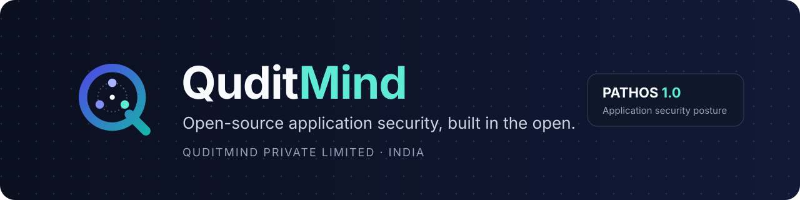

<p align="center">
  
</p>

<p align="center">
  <a href="https://github.com/quditmind/pathos/releases/latest"></a>
  <a href="https://github.com/quditmind/pathos/actions/workflows/ci.yml"></a>
  <a href="https://github.com/quditmind/pathos/blob/main/LICENSE"></a>
  <a href="https://github.com/quditmind/pathos/security/policy"></a>
</p>

## About QuditMind

**QuditMind Private Limited** is an Indian software company that builds open-source application security tools. Our first product is **[PATHOS](https://github.com/quditmind/pathos)**, an Application Security Posture Management (ASPM) platform that you run on your own infrastructure.

| | |
|---|---|
| **Legal name** | QUDITMIND PRIVATE LIMITED |
| **Type** | Private company limited by shares, incorporated under the Companies Act, 2013 |
| **Incorporated** | 5 November 2026, Central Registration Centre, Ministry of Corporate Affairs, Government of India |
| **Corporate Identity Number (CIN)** | `U62020AP2026PTC129304` |
| **State of registration** | Andhra Pradesh, India |
| **Business activity** | Software and computer consultancy (NIC 62020) |

### Verify us yourself

You don't have to take our word for it:

1. **The company.** On the [Ministry of Corporate Affairs portal](https://www.mca.gov.in/), open *MCA Services → Master Data → View Company or LLP Master Data* and search for CIN `U62020AP2026PTC129304`. The official record shows the name, status, incorporation date and registered office.
2. **The code.** Everything is public under the Apache License 2.0: read it, build it, scan it.
3. **The releases.** Every release image is signed and can be checked before you run it (see below).

---

## PATHOS — Application Security Posture Management

PATHOS brings source-code scanning, findings management, vulnerability intelligence, SBOMs and posture analytics together in one self-hosted platform.

<p align="center">
  
  
</p>

- **25 scan types:** SAST, DAST, SCA, secrets, IaC, containers, API security, mobile (Android and iOS), fuzzing, licences, SBOM, malware, code-quality security, supply chain, cryptography, configuration, CI/CD pipelines, binaries, AI/LLM, runtime, compliance, database security, licence policy, IAST (imported) and manual review, with a live coverage view.
- **Runs the tools itself:** 80 open-source scanners in isolated, signed worker images (core plus opt-in SAST, IaC, SCA, DAST, mobile, binary, AI and fuzzing images), including Gitleaks, Opengrep, Semgrep, Bandit, gosec, TruffleHog, Trivy, Grype, OSV-Scanner, govulncheck, Checkov, KICS, Kubescape, OWASP ZAP, Wapiti, testssl.sh, mobsfscan, capa, YARA-X, ModelScan, garak and promptfoo. Attack tools run only on targets you have authorized for intrusive testing.
- **Import from other tools:** 232 report formats from 207 tools (SARIF producers such as CodeQL, Fortify, Veracode, Checkmarx, Snyk, SonarQube, Burp, Acunetix, Nessus, Qualys, Wiz, Prisma Cloud, AWS Security Hub, Contrast and more), with deduplication across sources.
- **Proof, not just findings:** function-level reachability with the call path to the vulnerable function; AI-proposed fixes that are applied, re-scanned and (optionally) tested in a network-less sandbox before a person can open a pull request; opt-in live checks of whether a leaked key still works; and Kubernetes and registry context, so findings in deployed, internet-exposed workloads rise to the top.
- **Fix it, don't just find it:** automatic dependency-upgrade pull requests, secret push protection hooks, VEX statements per application release and detection of security-relevant code changes.
- **Repositories and assets:** GitHub, GitLab, Bitbucket Cloud and Azure DevOps, or local uploads; ownership, applications and business context.
- **Risk:** contextual 0–100 risk scores with EPSS, CISA KEV and OSV, reachability, attack paths, blast radius and posture by application, team or region.
- **Human Eye:** manual expert review with evidence, independent approval and full history.
- **AI, under your control:** AI-assisted triage and an AI Security Analyst with Anthropic, OpenAI, xAI or a **local model (Ollama)**. AI never decides on its own; people approve.
- **Governance:** security policies, SLAs, risk acceptance, compliance views (OWASP Top 10, ASVS, PCI DSS, ISO 27001, SOC 2), SSO with SAML or OIDC, MFA and an audit log.
- **Developer workflow:** the `pathos` command-line tool, ready-made CI templates (GitHub Actions, GitLab CI, Azure Pipelines, Jenkins, pre-commit) and a VS Code extension.
- **Integrations:** REST API, webhooks (Slack, Microsoft Teams), Jira, ServiceNow, pull request checks and an MCP server.
- **Runs anywhere Docker runs**, including fully **air-gapped** installations.

### Install

The only requirement is Docker with the Compose plugin.

```bash
git clone --branch v2.1.0 https://github.com/quditmind/pathos.git && cd pathos
./deploy/scripts/install.sh      # generates .env with random secrets and prints the admin login
docker compose up -d --wait
```

Open `https://localhost` and sign in. To use the pre-built signed images instead of building locally, see [Installing a release](https://github.com/quditmind/pathos/blob/main/docs/OPERATIONS.md#installing-a-release-signed-images).

---

## How PATHOS compares

There are good tools in this space. This is how PATHOS differs, so you can pick what fits.

| | **PATHOS** | DefectDojo | OWASP Dependency-Track | GitHub Advanced Security | Commercial ASPM suites¹ |
|---|---|---|---|---|---|
| Licence | Apache-2.0 | BSD-3-Clause (Pro edition paid) | Apache-2.0 | Paid, per active committer | Paid, commercial |
| Self-hosted | ✅ Docker Compose | ✅ | ✅ | GitHub Enterprise Server only | Mostly SaaS |
| Air-gapped / offline | ✅ Offline mode and database bundles | ✅ | ✅ (with mirrors) | ❌ | Rarely |
| Runs the scanners for you | ✅ 80 scanners in isolated, signed worker images | ❌ Imports results | ❌ Analyses SBOMs | ✅ CodeQL, secret scanning | ✅ |
| Source scanning (SAST, secrets, IaC) | ✅ | Via imports | ❌ | ✅ | ✅ |
| Imports results from other tools | ✅ 232 formats from 207 tools | ✅ Core strength (hundreds of parsers) | SBOMs only | SARIF | ✅ |
| Automatic fix pull requests | ✅ Dependency upgrades | ❌ | ❌ | ✅ Dependabot | ✅ |
| Secret push protection | ✅ Pre-commit and pre-receive hooks | ❌ | ❌ | ✅ | Varies |
| CLI, CI templates and IDE extension | ✅ CLI, 5 CI systems, VS Code | API and CI | API and CI | ✅ | ✅ |
| Dependencies and SBOMs | ✅ Import and export, CycloneDX and SPDX, VEX | Via imports | ✅ Core strength | ✅ Dependabot | ✅ |
| Containers, web apps and APIs (DAST) | ✅ Trivy, Nuclei, OWASP ZAP, Wapiti, Schemathesis | Via imports | ❌ | ❌ | Varies |
| Mobile apps, binaries and AI/LLM endpoints | ✅ APK/IPA analysis, CVE Binary Tool, capa, ModelScan, garak | Via imports | ❌ | ❌ | Varies |
| GitHub, GitLab, Bitbucket and Azure DevOps | ✅ All four | Via imports and CI | Via CI | GitHub only | ✅ |
| Contextual risk (EPSS, KEV, reachability, business context) | ✅ Explainable 0–100 score, function-level reachability, deployment and exposure | Partial | EPSS, policies | Partial | ✅ |
| Structured human review with independent approval | ✅ Human Eye | Risk acceptance | Audit and suppression | Dismissal | Varies |
| AI with a **local model** option | ✅ Ollama, or Anthropic, OpenAI, xAI, always human-approved | ❌ | ❌ | Cloud only | Cloud only |
| MCP server for AI assistants | ✅ | ❌ | ❌ | ❌ | Varies |

<sub>Based on each project's public documentation as of November 2026; features change, so check the vendor before deciding. ¹ For example Snyk, Checkmarx One, Apiiro, ArmorCode, Cycode. Their offerings differ widely.</sub>

### Why teams choose PATHOS

- **One platform, end to end, with no licence fees.** Scanning, findings, SBOMs, risk, human review, policies, compliance and reporting in one place, instead of a scanner plus an aggregator plus a spreadsheet.
- **Your code never leaves your servers.** Self-hosted by design, offline mode for air-gapped networks, and AI that can run entirely on a local model.
- **Risk you can explain.** Every score shows its factors (severity, EPSS, CISA KEV, reachability, exposure, criticality), so prioritisation can be defended in an audit.
- **People stay in charge.** AI suggests; people decide. Human Eye adds evidence, four-eyes approval and an immutable history.
- **Open and verifiable.** Read every line, build it yourself, and verify every signed release.

### Where others are stronger today

- **DefectDojo** has years of community use and parsers for hundreds of tools.
- **Dependency-Track** goes deeper on SBOM portfolio and policy management.
- **Commercial suites** bring proprietary analysis engines, managed hosting and contractual support.
- **PATHOS** is new (2.1.0 released November 2026). QuditMind can offer support, and issues and pull requests are welcome.

---

## Is it safe to use?

We build a security product, so we hold it to the standard we ask of others. Each point below can be checked independently.

| What | How you can check it |
|---|---|
| **Open source** | All code is public under [Apache-2.0](https://github.com/quditmind/pathos/blob/main/LICENSE). No closed components, no licence keys. |
| **Self-hosted, your data stays with you** | PATHOS runs on your servers. It does not call home to QuditMind, and every outbound connection is listed with its default in [docs/SECURITY.md](https://github.com/quditmind/pathos/blob/main/docs/SECURITY.md). Offline mode turns them all off. |
| **Signed releases** | Release images on `ghcr.io/quditmind` are signed with Sigstore cosign (keyless, tied to the release workflow) and carry an SBOM and SLSA provenance. |
| **Tested on every change** | CI runs unit, integration, browser and full-stack tests plus **gosec**, **govulncheck**, **Trivy** image scans and **OWASP ZAP** DAST (baseline and authenticated) against PATHOS itself. |
| **Supply chain** | Dependencies are pinned and updated by Dependabot; third-party GitHub Actions are pinned to commit SHAs. |
| **Least privilege** | Scoped role-based access control, CSRF protection, encrypted secrets at rest, isolated scan workers behind an egress proxy, and a complete audit log. |
| **Responsible disclosure** | Report vulnerabilities privately through [GitHub security advisories](https://github.com/quditmind/pathos/security/advisories/new); see the [security policy](https://github.com/quditmind/pathos/security/policy). |

Verify a release image before you deploy it:

```bash
cosign verify ghcr.io/quditmind/pathos:2.1.0 \
  --certificate-identity "https://github.com/quditmind/pathos/.github/workflows/release.yml@refs/tags/v2.1.0" \
  --certificate-oidc-issuer https://token.actions.githubusercontent.com
```

---

<p align="center">
  <br>
  <sub>© 2026 QuditMind Private Limited · CIN U62020AP2026PTC129304 · PATHOS is licensed under Apache-2.0</sub>
</p>
